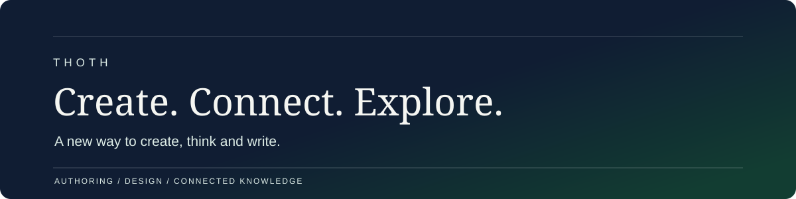

  
  <h1>THOTH</h1>
  

  
<strong>Create. Connect. Explore.</strong>

  
Professional authoring · Creative design · Connected knowledge

  
<a href="#what-makes-it-different">Experience</a> · <a href="#current-state-vs-intended-capabilities">Status</a> · <a href="#development-direction">Roadmap</a> · <a href="docs/README.md">Documentation</a>

  
<em>Early prototype · React · TypeScript · Not production ready</em>

---

## One connected workspace

| Create | Design | Seshat |
| :--- | :--- | :--- |
| Write naturally with dependable manual editing. | Shape documents with flexible layouts and reusable styles. | Explore connected project knowledge and optional reviewed assistance. |

These are the intended experience pillars, not a claim that the latest walkthrough is implemented in the repository. See the [design handoff](docs/design/walkthrough.md).

THOTH is a **manual-first, local-first-in-direction professional document studio** for business, technical and creative work. It aims to combine dependable word-processing controls with reusable document systems, project knowledge, researched guidance and optional AI assistance. These are product goals, not claims about the current build.

## Experience preview

Explore the original Canva design references: [workspace concept](https://www.canva.com/d/hhmmqyUgPucLW34), [approved blended theme study](https://www.canva.com/d/4gkdILBLijS5sOw) and [v1.3 user journeys](https://www.canva.com/d/rCGaKjHgZLXKBkv). Canva access may be required. These are design references, not screenshots of implemented functionality. The interactive walkthrough and verified image exports are not yet available in this repository.

## Why I created THOTH

I first thought of THOTH when I wanted to create guides for work. I found that producing them in Microsoft Word took longer than it should. There were too many repetitive steps involved in setting up the document, organising the content, managing images, keeping the formatting consistent and preparing everything for the final result.

I wanted something more bespoke. I wanted an authoring platform that could understand what I was trying to create, help me structure it properly and make the whole process smarter. AI could assist where it was useful, but I did not want it to take over or remove my control.

That idea became THOTH. My goal is to build the tool I would choose instead of Word for creating professional guides, documentation, specifications and other structured documents. It should provide the freedom and reliability of a serious word processor while offering better templates, stronger project organisation, connected knowledge and optional intelligent assistance.

THOTH is being designed so that everything can still be done manually. AI should understand the document and help when requested, but its suggestions must be transparent, reviewable and grounded in reliable standards, research and project evidence.

## What THOTH is being built for

Professional guides and SOPs, technical and architecture specifications, business documents, game design documents, animation and comic scripts, and general documents. Different [document profiles](docs/product/document-profiles.md) should offer appropriate components, styles and optional checks, without restricting freeform editing.

## Current state vs intended capabilities

| Area | Available in current main prototype | Intended, not implemented |
| --- | --- | --- |
| Authoring | React/TypeScript application with a BlockNote rich-text demonstration | Saved documents, semantic components, full manual authoring, review and recovery |
| Workspace | Three resizable columns; selected-section synchronisation | Customisable layouts, focus mode, saved preferences and themes |
| Navigation | Heading-based placeholder tiles labelled as pages | Distinct outline navigation and *literal* laid-out page thumbnails |
| Knowledge | Animated Three.js graph with generated nodes and connections | **Seshat**, the real, editable, linked Interactive Knowledge Map |
| Document output | Header displays Save/Export icons without wired actions | Reliable page preview, PDF and interoperable formats |
| AI | No working component-aware chat/edit workflow identified | Optional scoped, reviewable edits grounded in current project sources |

This table reflects source inspected on main at commit [ba9f894](https://github.com/dktn7/thoth/commit/ba9f894a5d3f9e929c39373268122d16806527e7), **not** a running-app QA result. Unpushed local work is unknown. The name and existing blue ibis/green-eye logo are retained.

## What makes it different

A complete document should be possible **without AI**. Templates, rules, styles, page layout and accessible publishing should work deterministically. Optional AI can consult authorised project context, target a selection/component/section, and propose changes for approval; it must never silently replace unrelated content.

**Seshat · Interactive Knowledge Map** will organise project sources, images, concepts and relationships with provenance and navigation in both directions. Today's Neural Brain visual is a demonstration, not that system. [Seshat specification](docs/product/seshat.md).

## Development direction

Browser first, with a platform-independent document model and storage/export adapters, then evaluate desktop packaging after the core workflows are stable. BlockNote is declared in the current prototype dependencies but the long-term editor-engine decision remains open. Local-first is the target architecture; durable local storage is **not yet established in main**.

See [PRODUCT.md](PRODUCT.md), [SPECIFICATIONS.md](SPECIFICATIONS.md), [ROADMAP.md](ROADMAP.md), [architecture](docs/architecture/overview.md), [styles and templates](docs/product/styles-templates.md) and [research evidence](docs/research/evidence-register.md).

## Run the current prototype

Prerequisites: Node.js and npm. From the repository root:

    npm install
    npm run dev

Available scripts:

    npm run lint
    npm run test
    npm run build

The repository currently includes multiple lockfiles (npm and Bun). **Package-manager standardisation is still an open task**; dependency installation may update local lockfiles. No CI assurance is claimed here.

## Contributing

Follow [CONTRIBUTING.md](CONTRIBUTING.md) and [AGENTS.md](AGENTS.md). Changes go through branches and reviewable pull requests, not direct pushes to main. Please do not describe roadmap items as working features. This repository is evolving; the foundation documents define intent while verified code and tests determine actual capability.

## Brand

THOTH is the product name; **Seshat** names the Interactive Knowledge Map. The existing mark at [src/assets/thoth-logo.jpg](src/assets/thoth-logo.jpg) is the current source asset. [Brand guidance](docs/assets/brand/README.md) documents constraints and outstanding variants.
